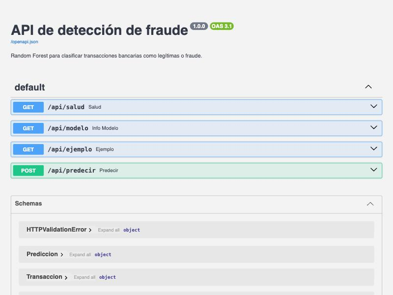
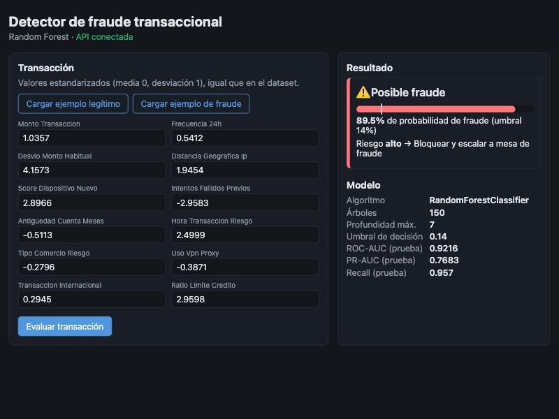
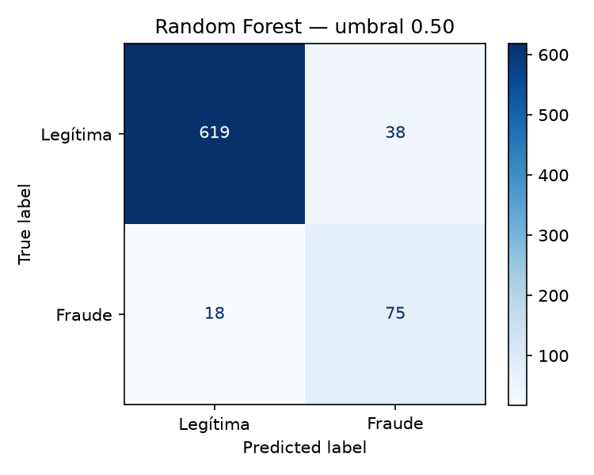
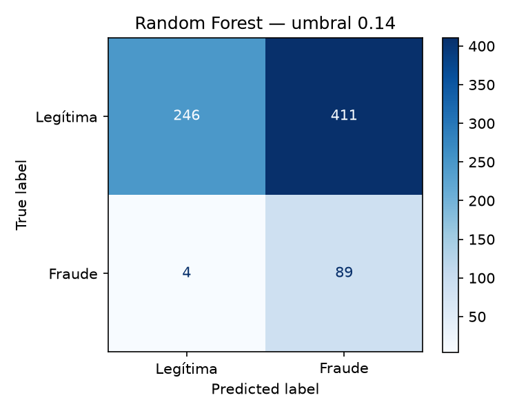
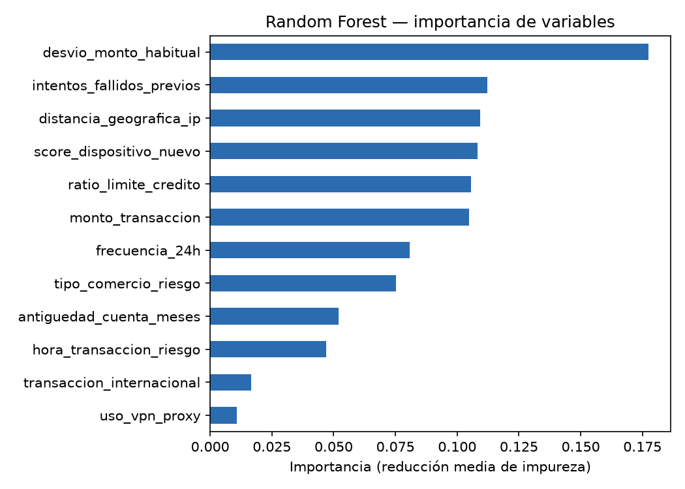

# Changelog

Este archivo reúne la documentación técnica del proyecto: arquitectura, integración por API,
contenerización, validación y pruebas, y despliegue.

| | |
|---|---|
| **Actividad** | FASE II |
| **Alumno** | Manuel de Jesus Ramiro Velázquez Tapia |
| **Matrícula** | AL07183522 |
| **Docente** | Luis Ariel Vazquez Piña |

**Contenido**

1. [Arquitectura e integración por API](#1-arquitectura-e-integración-por-api)
2. [Contenedor Docker funcional](#2-contenedor-docker-funcional)
3. [Documento de validación y pruebas](#3-documento-de-validación-y-pruebas)
4. [Estrategias de despliegue en la nube](#4-estrategias-de-despliegue-en-la-nube)
5. [Consideraciones del modelo en producción](#5-consideraciones-del-modelo-en-producción)

## 1. Arquitectura e integración por API

### Arquitectura

```
                 Navegador
                     │  http://localhost:8080
                     ▼
┌─────────────────────────────────────┐        ┌────────────────────────────────────────┐
│ Contenedor fraude-frontend          │        │ Contenedor fraude-backend              │
│ nginx 1.27 (alpine)                 │ /api/* │ Python 3.14 + FastAPI + Uvicorn        │
│  • Sirve index.html, app.js, CSS    │───────▶│  • Carga modelo_random_forest.joblib   │
│  • Proxy inverso /api → backend:8000│        │  • GET /api/salud, /api/modelo,        │
└─────────────────────────────────────┘        │        /api/ejemplo                    │
             puerto 8080 → 80                  │  • POST /api/predecir                  │
                                               └────────────────────────────────────────┘
                                                            puerto 8000 → 8000
                    Red interna de Docker Compose: faseii_default
```

| Componente | Tecnología | Responsabilidad |
|---|---|---|
| Modelo | scikit-learn `RandomForestClassifier` | Estima la probabilidad de fraude de una transacción. |
| Backend | FastAPI + Uvicorn | Expone el modelo como API REST con validación de datos (Pydantic). |
| Frontend | HTML + JavaScript + nginx | Formulario para capturar la transacción y mostrar el resultado. |
| Orquestación | Docker Compose | Construye y levanta ambos contenedores en una red común. |

**Decisión de integración:** el navegador solo habla con nginx. nginx reenvía `/api/*` al servicio
`backend` por la red interna de Docker. Así frontend y API comparten origen, no hace falta configurar
CORS y el backend no necesita estar expuesto públicamente en producción.

### Estructura de archivos

```
faseII/
├── README.md
├── CHANGELOG.md                     # Este documento
├── MANUAL_NUBE.MD                   # Manual de despliegue en AWS (ECS Fargate + Bedrock)
├── docker-compose.yml               # Orquestación de los dos servicios
├── .dockerignore
├── requirements.txt                 # Dependencias para entrenar en local
├── datos/
│   ├── datos_fraude.csv             # Dataset (2,500 transacciones)
│   └── metricas_random_forest.json  # Métricas generadas al entrenar
├── fuentes/
│   ├── modelo_random_forest.py      # Entrenamiento y evaluación del modelo
│   ├── prueba_integracion.sh        # Pruebas extremo a extremo contra los contenedores
│   ├── backend/
│   │   ├── Dockerfile
│   │   ├── requirements.txt / requirements-dev.txt
│   │   ├── app/main.py              # API FastAPI
│   │   └── tests/test_api.py        # Pruebas unitarias de la API
│   └── frontend/
│       ├── Dockerfile
│       ├── nginx.conf               # Servidor estático + proxy /api
│       ├── index.html, app.js, estilos.css
└── imagenes/                        # Gráficas del modelo y capturas
```

### Contrato de la API

URL base: `http://localhost:8000/api` (directo) o `http://localhost:8080/api` (a través del frontend).
La documentación interactiva (Swagger/OpenAPI) se genera automáticamente en `http://localhost:8000/docs`.



| Método | Ruta | Descripción | Respuesta |
|---|---|---|---|
| GET | `/api/salud` | Estado del servicio (lo usa el *healthcheck*). | `{"estado":"ok","modelo_cargado":true}` |
| GET | `/api/modelo` | Algoritmo, hiperparámetros, variables, umbral y métricas. | JSON con la ficha del modelo |
| GET | `/api/ejemplo?tipo=legitima\|fraude` | Transacción real del dataset para probar. | Las 12 variables |
| POST | `/api/predecir` | Clasifica una transacción. | Probabilidad, decisión y acción |

**Ejemplo de petición:**

```bash
curl -X POST http://localhost:8080/api/predecir \
  -H 'Content-Type: application/json' \
  -d '{"monto_transaccion": 1.04, "frecuencia_24h": 0.54, "desvio_monto_habitual": 4.16,
       "distancia_geografica_ip": 1.95, "score_dispositivo_nuevo": 2.90,
       "intentos_fallidos_previos": -2.96, "antiguedad_cuenta_meses": -0.51,
       "hora_transaccion_riesgo": 2.50, "tipo_comercio_riesgo": -0.28, "uso_vpn_proxy": -0.39,
       "transaccion_internacional": 0.29, "ratio_limite_credito": 2.96}'
```

**Respuesta:**

```json
{
  "probabilidad_fraude": 0.895,
  "umbral": 0.14,
  "es_fraude": true,
  "nivel_riesgo": "alto",
  "accion": "Bloquear y escalar a mesa de fraude"
}
```

**Reglas de decisión.** El umbral (0.14) es el que minimiza el costo total
(1,500 × FN + 25 × FP) en validación cruzada sobre el entrenamiento:

| Probabilidad | Nivel | Acción |
|---|---|---|
| < 0.14 | bajo | Aprobar transacción |
| 0.14 – 0.50 | medio | Retener y solicitar autenticación reforzada |
| ≥ 0.50 | alto | Bloquear y escalar a mesa de fraude |

**Validación de entrada.** Pydantic exige las 12 variables, todas numéricas, finitas (sin `NaN` ni
`Infinity`) y entre **−100 y 100** (en el dataset ninguna supera |10.06|), y rechaza campos desconocidos.
Cualquier error devuelve `422` con el detalle del campo, que el frontend muestra al usuario.

## 2. Contenedor Docker funcional

### Construcción de las imágenes

**Backend (`fuentes/backend/Dockerfile`) — construcción multi-etapa**

1. **Etapa `entrenamiento`** (`python:3.14-slim`):
   - Instala dependencias de entrenamiento y pruebas.
   - Copia el dataset y `modelo_random_forest.py`, y **entrena el modelo dentro de la imagen**
     (`random_state=42`, por lo que es reproducible). Genera `modelos/modelo_random_forest.joblib`.
   - Copia la API y **ejecuta `pytest`**: si alguna prueba falla, la construcción se detiene y no se
     genera una imagen defectuosa.
2. **Etapa final** (`python:3.14-slim`):
   - Instala solo las dependencias de ejecución (sin pytest ni httpx).
   - Copia únicamente el artefacto `.joblib`, el dataset (para `/api/ejemplo`) y el código de la API.
   - Corre como usuario sin privilegios `api` (UID 1000).
   - Define un `HEALTHCHECK` contra `/api/salud` cada 10 s.
   - Arranca con `uvicorn app.main:app --host 0.0.0.0 --port 8000`.

Las rutas del modelo y de los datos se inyectan con variables de entorno (`RUTA_MODELO`, `RUTA_DATOS`),
y el umbral puede sobreescribirse con `UMBRAL_DECISION` sin reconstruir la imagen.

**Frontend (`fuentes/frontend/Dockerfile`)**

- Basado en `nginx:1.27-alpine`.
- Copia `nginx.conf` (archivos estáticos + `location /api/ { proxy_pass http://backend:8000/api/; }`)
  y los tres archivos web.
- `HEALTHCHECK` con `wget` a la página principal.

**Orquestación (`docker-compose.yml`)**

- `backend`: construido desde la raíz (necesita `datos/` y `fuentes/`), puerto `8000:8000`.
- `frontend`: puerto `8080:80`, con `depends_on: condition: service_healthy`, de modo que nginx no
  arranca hasta que la API responde.
- Ambos con `restart: unless-stopped`.
- `.dockerignore` excluye `.venv`, `.git`, cachés, `modelos/` e `imagenes/` para que el contexto de
  construcción sea pequeño y el modelo siempre se entrene dentro de la imagen.

### Imagen construida correctamente

```bash
docker compose build
```

```
#25 Modelo guardado en modelos/modelo_random_forest.joblib
#23 19 passed, 1 warning in 4.22s
 Image faseii-frontend:1.0.0 Built
 Image faseii-backend:1.0.0 Built
```

- Reconstrucción desde cero (`docker compose build --no-cache`) el 2026-11-01 sobre el commit `68c1b3f`,
  en 60 s, sin errores. Después se reconstruyeron con los cambios de validación y del frontend:

  | Imagen | ID | Tamaño | Base |
  |---|---|---|---|
  | `faseii-backend:1.0.0` | `bb22ae9ebde2` | 660 MB | `python:3.14-slim` (multi-etapa) |
  | `faseii-frontend:1.0.0` | `bbc1ea066d4d` | 49.7 MB | `nginx:1.27-alpine` |

- Durante la construcción del backend se entrena el modelo y se ejecutan las pruebas unitarias
  (`19 passed`). Si una prueba falla, la imagen no se genera.
- El backend pesa 660 MB por Python + numpy/pandas/scikit-learn; solo incluye las dependencias de
  ejecución, el modelo entrenado, el dataset y el código de la API.

### Ejecución local comprobable

Requisitos: Docker Desktop en marcha (probado con Docker 24.0.6 y Docker Compose v5.6.1 en macOS arm64).

```bash
docker compose up -d --build     # construir y levantar
docker compose ps                # ver estado y salud
docker compose logs -f backend   # ver logs de la API
bash fuentes/prueba_integracion.sh
docker compose down              # detener y eliminar contenedores
```

Resultado obtenido:

| Contenedor | Estado | Puertos |
|---|---|---|
| `fraude-backend` | Up (healthy) | `8000 → 8000` |
| `fraude-frontend` | Up (healthy) | `8080 → 80` |

- Aplicación web en <http://localhost:8080>; API y Swagger en <http://localhost:8000/docs>.
- El frontend solo arranca cuando el *healthcheck* del backend (`/api/salud`) está en verde
  (`depends_on: condition: service_healthy`).
- Prueba de integración tras la reconstrucción: «Todas las pruebas de integración pasaron».



**Ejecución sin Docker (desarrollo):**

```bash
python3 -m venv .venv
.venv/bin/pip install -r fuentes/backend/requirements-dev.txt
.venv/bin/python fuentes/modelo_random_forest.py               # entrena y guarda el modelo
cd fuentes/backend && ../../.venv/bin/uvicorn app.main:app --reload
```

## 3. Documento de validación y pruebas

### Validación del modelo

Resultados de `fuentes/modelo_random_forest.py` (guardados en `datos/metricas_random_forest.json`).
Partición estratificada 70/30: 1,750 registros de entrenamiento (217 fraudes) y 750 de prueba
(93 fraudes, 12.4 %). Hiperparámetros: `n_estimators=150`, `max_depth=7`, `min_samples_split=10`,
`min_samples_leaf=4`, `class_weight='balanced'`, `random_state=42`.

**Capacidad de discriminación y sobreajuste**

| Métrica | Entrenamiento | Validación cruzada (5 pliegues) | Prueba |
|---|---|---|---|
| ROC-AUC | 0.9937 | 0.9203 | **0.9216** |
| PR-AUC | 0.9673 | 0.7754 | **0.7686** |

- **ROC-AUC 0.92**: el modelo ordena bien las transacciones; un fraude elegido al azar recibe más
  probabilidad que una legítima elegida al azar en el 92 % de los casos.
- **PR-AUC 0.77** frente a una línea base de 0.124 (la proporción de fraudes): es la métrica relevante
  con clases desbalanceadas y está más de 6 veces por encima de un clasificador aleatorio.
- **Sobreajuste moderado**: el modelo se ajusta mucho mejor a los datos con que se entrenó (0.99) que a
  datos nuevos (0.92). La validación cruzada y la prueba coinciden (0.920 y 0.922), así que la
  estimación de desempeño es estable y no depende de una partición afortunada. Bajar `max_depth` o
  subir `min_samples_leaf` reduciría la brecha; queda como mejora para una siguiente iteración.

**Umbral de decisión y costo**

El umbral se eligió minimizando el costo total (1,500 × FN + 25 × FP) con predicciones fuera de
pliegue del entrenamiento; el conjunto de prueba solo se usó para medir.

| Umbral | Recall | Precision | F2 | TP | FN | FP | TN | Costo total |
|---|---|---|---|---|---|---|---|---|
| 0.50 (por defecto) | 0.806 | 0.664 | 0.773 | 75 | 18 | 38 | 619 | $27,950 |
| **0.14 (mínimo costo)** | **0.957** | 0.178 | 0.510 | **89** | **4** | 411 | 246 | **$16,275** |

| Umbral 0.50 | Umbral 0.14 |
|---|---|
|  |  |

- Bajar el umbral a 0.14 reduce los fraudes no detectados de 18 a 4 y el costo total un **42 %**.
- A cambio, las falsas alarmas suben de 38 a 411 (63 % de las legítimas). Por costo directo conviene,
  porque cada fraude no detectado cuesta 60 veces más que una falsa alarma, pero esa cantidad de
  bloqueos genera fricción con el cliente. Por eso la API usa el nivel «medio» (0.14–0.50) para pedir
  autenticación reforzada y reserva el bloqueo para el nivel «alto» (≥ 0.50).

**Importancia de variables**



| Variable | Importancia |
|---|---|
| `desvio_monto_habitual` | 0.177 |
| `intentos_fallidos_previos` | 0.112 |
| `distancia_geografica_ip` | 0.109 |
| `score_dispositivo_nuevo` | 0.108 |
| `ratio_limite_credito` | 0.106 |
| `monto_transaccion` | 0.105 |
| `frecuencia_24h` | 0.081 |
| `tipo_comercio_riesgo` | 0.075 |
| `antiguedad_cuenta_meses` | 0.052 |
| `hora_transaccion_riesgo` | 0.047 |
| `transaccion_internacional` | 0.017 |
| `uso_vpn_proxy` | 0.011 |

- La señal más fuerte es que el monto se aleje del comportamiento habitual del cliente, seguida de
  intentos fallidos previos, distancia de la IP y dispositivo nuevo: patrones típicos de toma de cuenta.
- `uso_vpn_proxy` y `transaccion_internacional` casi no aportan. Son candidatas a revisar o eliminar.
- La importancia por reducción de impureza favorece variables continuas; para confirmar el orden
  convendría calcular importancia por permutación.

**Comportamiento ante valores fuera de rango.** Con todas las variables en ±10 o ±100 el modelo
devuelve la misma probabilidad (0.6252 / 0.6487): un Random Forest no extrapola y fuera del rango de
entrenamiento siempre cae en las hojas extremas (ver «Casos extremos evaluados»).

### Pruebas funcionales realizadas

| Tipo | Herramienta | Casos | Resultado |
|---|---|---|---|
| Unitarias de la API | pytest (`fuentes/backend/tests/test_api.py`) | 19: salud, ficha del modelo, ejemplos, estructura de la predicción, fraude con más probabilidad que legítima, validaciones 422 y valores extremos | ✅ 19 passed (en local y en cada `docker build`) |
| Integración extremo a extremo | `fuentes/prueba_integracion.sh` (navegador → nginx → API → modelo) | 9 comprobaciones: estáticos, proxy `/api`, ejemplo con 12 variables, predicciones, 422 y 404 | ✅ 9/9 |
| Funcional en navegador | Interfaz en `localhost:8080` | Conexión con la API, formulario dinámico, carga de ejemplo y evaluación | ✅ Ejemplo de fraude: 89.5 %, riesgo alto → bloquear |
| Resiliencia | `docker stop` / `docker start` del backend | Caída y recuperación | ✅ La página sigue disponible, muestra «API no disponible» y se recupera sola |
| Rendimiento | 200 peticiones `POST /api/predecir` | Latencia y memoria | ✅ Media 28.7 ms, p95 31.0 ms; backend ~154 MiB |

#### Pruebas unitarias de la API (pytest)

Se ejecutan en local y **automáticamente en cada `docker build`**:

```bash
.venv/bin/pytest fuentes/backend/tests -v
```

| # | Prueba | Qué valida | Resultado |
|---|---|---|---|
| 1 | `test_salud` | `/api/salud` responde 200 y el modelo está cargado | ✅ |
| 2 | `test_info_modelo` | Algoritmo, `n_estimators=150`, `max_depth=7`, 12 variables, umbral en (0,1) | ✅ |
| 3–4 | `test_ejemplo_devuelve_las_12_variables` | Ejemplos legítimo y de fraude traen las 12 variables | ✅ |
| 5 | `test_ejemplo_tipo_invalido` | Un `tipo` desconocido devuelve 422 | ✅ |
| 6 | `test_predecir_estructura_respuesta` | Probabilidad en [0,1] y `es_fraude` coherente con el umbral | ✅ |
| 7 | `test_fraude_recibe_mas_probabilidad_que_legitima_en_promedio` | El modelo asigna más probabilidad a fraudes reales (30 vs 30) | ✅ |
| 8 | `test_predecir_falta_variable` | Falta una variable → 422 | ✅ |
| 9 | `test_predecir_variable_extra` | Campo desconocido → 422 | ✅ |
| 10 | `test_predecir_valor_no_numerico` | Texto en un campo numérico → 422 | ✅ |
| 11–17 | `test_predecir_rechaza_valores_extremos` | `NaN`, `Infinity`, `-Infinity`, `±1e308`, `1e6` y `100.01` → 422 en el campo correcto | ✅ |
| 18–19 | `test_predecir_acepta_valores_en_el_limite` | `100` y `−100` (límites) → 200 | ✅ |

Resultado: **19 passed**.

#### Pruebas de integración extremo a extremo

`fuentes/prueba_integracion.sh` recorre el mismo camino que el navegador
(**cliente → nginx → backend → modelo**) con los contenedores levantados:

```bash
bash fuentes/prueba_integracion.sh            # por defecto http://localhost:8080
```

```
OK    Frontend sirve index.html
OK    Frontend sirve app.js
OK    Proxy /api/salud -> backend
OK    Proxy /api/modelo -> backend
OK    Ejemplo legítimo tiene 12 variables
OK    Predicción de ejemplo legítimo
OK    Predicción de ejemplo de fraude
      legítima -> {"probabilidad_fraude":0.2678,"umbral":0.14,"es_fraude":true,"nivel_riesgo":"medio",...}
      fraude   -> {"probabilidad_fraude":0.7613,"umbral":0.14,"es_fraude":true,"nivel_riesgo":"alto",...}
OK    JSON incompleto devuelve 422
OK    Ruta inexistente de la API da 404

Todas las pruebas de integración pasaron.
```

> El ejemplo legítimo quedó marcado como riesgo medio: es esperable con el umbral de 0.14, que
> prioriza no dejar pasar fraudes (recall 95.7%) a costa de más falsas alarmas (ver sección 5).

#### Prueba funcional en el navegador

En <http://localhost:8080> se verificó que:

1. Al cargar la página el indicador cambia a **«API conectada»** y se muestra la ficha del modelo
   (obtenida de `/api/modelo`).
2. El formulario de 12 campos se genera dinámicamente con las variables que devuelve la API.
3. **«Cargar ejemplo de fraude»** rellena el formulario desde `/api/ejemplo`.
4. **«Evaluar transacción»** envía un `POST /api/predecir` y muestra: *Posible fraude, 89.5 %, riesgo
   alto → Bloquear y escalar a mesa de fraude* (captura de la sección 2).

#### Resiliencia

| Escenario | Resultado |
|---|---|
| Se detiene el backend (`docker stop fraude-backend`) | El frontend sigue sirviendo la página (200); `/api/salud` devuelve **502** y la interfaz muestra «API no disponible» y «Error 502: el servicio de la API no responde.» |
| Se vuelve a iniciar el backend | En pocos segundos pasa a `healthy` y `/api/salud` vuelve a responder `{"estado":"ok"}` sin reiniciar el frontend. |
| El backend no arranca (error en el código) | Compose detecta `unhealthy` y **no levanta el frontend** (`dependency failed to start`). Se comprobó durante el desarrollo. |

#### Rendimiento y recursos

200 peticiones `POST /api/predecir` consecutivas a través de nginx:

| Métrica | Valor |
|---|---|
| Latencia media | 28.7 ms |
| p50 / p95 / máx. | 28.4 / 31.0 / 45.2 ms |
| Memoria backend | ~154 MiB |
| Memoria frontend | ~8 MiB |

### Casos extremos evaluados

Ejecutados contra `http://localhost:8080/api/predecir` (a través de nginx) el 2026-11-01.

**Entradas inválidas — se rechazan correctamente:**

| Caso | Respuesta |
|---|---|
| JSON vacío `{}` | 422, indica las 12 variables faltantes |
| Cuerpo vacío | 422 |
| JSON mal formado | 422 (`JSON decode error`) |
| Arreglo en lugar de objeto | 422 |
| `null` o lista en una variable | 422 (`Input should be a valid number`) |
| Texto no numérico (`"alto"`) | 422 |
| Variable faltante o variable extra | 422 |
| `Content-Type: text/plain` | 422 |
| Cuerpo de 1 MB con un campo desconocido | 422 |
| `GET` en `/api/predecir` | 405 |
| Ruta inexistente `/api/no-existe` | 404 |
| Backend detenido | 502 desde nginx; la interfaz muestra un mensaje claro |

**Valores numéricos extremos:**

| Caso | Respuesta | Observación |
|---|---|---|
| Todas las variables en 0 (cerca de la media) | 200, prob. 0.2507, riesgo medio | Comportamiento esperado con umbral 0.14 |
| Todas en +10 | 200, prob. 0.6252, riesgo alto | El Random Forest no extrapola: fuera del rango de entrenamiento usa la última división de cada árbol |
| Todas en −10 | 200, prob. 0.6487, riesgo alto | Ídem |
| Todas en +100 (límite permitido) | 200, prob. 0.6252 | Igual que +10: confirma que el Random Forest no extrapola |
| Todas en +100.01 | 422 (`less_than_equal`) | Fuera del rango permitido [−100, 100] |
| Todas en ±1,000,000 | 422 | Fuera del rango permitido |
| Entero en lugar de decimal (`3`) | 200 | Conversión correcta |
| Número como texto (`"1.5"`) | 200 | Pydantic convierte el texto a número (modo flexible) |
| Booleano (`true`) | 200 | Pydantic lo convierte a `1.0` (modo flexible) |

**Defectos encontrados y corregidos:**

| Caso | Antes | Después |
|---|---|---|
| `Infinity` / `-Infinity` | **500** `Input X contains infinity…` | ✅ 422 `finite_number` |
| Valor muy grande (`1e308`) | **500** (desborda `float32` dentro de scikit-learn) | ✅ 422 `less_than_equal` |
| `NaN` | **200** con una predicción (prob. 0.1448) | ✅ 422 `finite_number` |

Corrección: cada variable admite solo números finitos entre −100 y 100 (en el dataset ninguna supera
|10.06|), y un manejador de errores convierte `NaN`/`Infinity` a texto para que la respuesta 422 sea
JSON válido. Se añadieron 9 pruebas unitarias (`test_predecir_rechaza_valores_extremos` y
`test_predecir_acepta_valores_en_el_limite`); la prueba de integración sigue pasando (9/9).

### Otros problemas encontrados durante las pruebas y su solución

| Problema | Causa | Solución |
|---|---|---|
| El backend arrancaba y quedaba `unhealthy` con `IndexError` | La ruta por defecto del modelo se calculaba con la estructura de carpetas del repositorio, que no existe dentro de la imagen (`/app/app/main.py`). | Las rutas se toman primero de `RUTA_MODELO` / `RUTA_DATOS` y solo si faltan se calcula la ruta del repositorio. |
| El frontend quedaba `unhealthy` aunque respondía | En Alpine `localhost` resuelve a IPv6 (`::1`) y nginx solo escucha en IPv4. | El *healthcheck* usa `http://127.0.0.1/`. |
| Con el backend caído la interfaz mostraba `Unexpected token '<'…` | nginx devuelve una página HTML de error 502 y el frontend intentaba leerla como JSON. | `app.js` detecta respuestas que no son JSON y muestra «Error 502: el servicio de la API no responde.» |

## 4. Estrategias de despliegue en la nube

> El procedimiento detallado para AWS (ECS Fargate + Amazon Bedrock) está en
> [MANUAL_NUBE.MD](MANUAL_NUBE.MD).

La aplicación ya está lista para la nube: dos imágenes inmutables, configuración por variables de
entorno, *healthchecks*, usuario sin privilegios y un único punto de entrada público (nginx).

### Flujo común

1. **Registro de imágenes**: publicar `faseii-backend` y `faseii-frontend` con etiqueta de versión
   (p. ej. `1.0.0` y el SHA del commit) en un registro privado.
2. **CI/CD con GitHub Actions** (el repositorio ya está en GitHub): en cada *push* a `main`,
   construir las imágenes (el `docker build` ya ejecuta las pruebas), ejecutar
   `prueba_integracion.sh` con `docker compose up`, publicar las imágenes y desplegar.
3. **Despliegue**: actualizar el servicio con la nueva etiqueta y verificar `/api/salud`.

Ejemplo de pipeline:

```yaml
# .github/workflows/despliegue.yml
on: { push: { branches: [main] } }
jobs:
  construir-probar-publicar:
    runs-on: ubuntu-latest
    steps:
      - uses: actions/checkout@v4
      - run: docker compose up -d --build        # entrena + pytest dentro del build
      - run: bash fuentes/prueba_integracion.sh  # pruebas extremo a extremo
      - run: docker compose down
      # login al registro, docker tag/push y despliegue según el proveedor elegido
```

### Opciones por proveedor

| Opción | Cómo se despliega | Ventajas | Consideraciones |
|---|---|---|---|
| **Google Cloud Run** | Dos servicios: frontend público y backend con acceso interno; `nginx.conf` apunta a la URL del backend. | *Serverless*, escala a cero, pago por petición, HTTPS automático. | Arranque en frío (~2–4 s por cargar scikit-learn); se mitiga con `min-instances=1`. |
| **AWS ECS Fargate + ALB** *(elegida, ver MANUAL_NUBE.MD)* | Imágenes en ECR, un servicio ECS por contenedor, *Application Load Balancer* con *health check*. | Sin servidores que administrar, integración con IAM, CloudWatch, Secrets Manager y Amazon Bedrock. | Más piezas de configurar (VPC, subredes, ALB). |
| **AWS App Runner** | Un servicio por imagen desde ECR. | El más sencillo en AWS. | Menos control de red. |
| **Azure Container Apps** | Imágenes en ACR, *ingress* externo para el frontend e interno para el backend. | Escalado por peticiones, revisiones para *blue/green*. | — |
| **Kubernetes (EKS / GKE / AKS)** | `Deployment` + `Service` por componente, `Ingress` para el frontend, `readinessProbe` en `/api/salud`, HPA. | Máximo control y portabilidad. | Mayor complejidad operativa; se justifica a gran escala. |

### Buenas prácticas para producción

- **Seguridad**: exponer solo el frontend/balanceador; backend en red privada. HTTPS en el balanceador.
  Autenticación de la API (API key u OAuth2) antes de abrirla a otros sistemas. Escaneo de
  vulnerabilidades de imágenes (Trivy, ECR/Artifact Registry scanning).
- **Configuración**: umbral y rutas por variables de entorno (`UMBRAL_DECISION`), secretos en el
  gestor del proveedor, nunca en la imagen.
- **Escalado**: el backend es *stateless*, por lo que escala horizontalmente. Escalar por CPU o por
  número de peticiones concurrentes.
- **Despliegues sin corte**: *rolling update* o *blue/green* usando `/api/salud` como *readiness check*.
- **Observabilidad**: logs estructurados a CloudWatch / Cloud Logging, métricas de latencia y tasa de
  errores, y monitoreo de la **distribución de probabilidades** para detectar *drift* del modelo.
- **Gestión del modelo**: versionar el artefacto `.joblib` (registro de modelos o almacenamiento de
  objetos) para reentrenar sin reconstruir la imagen de la API.

## 5. Consideraciones del modelo en producción

- Con el umbral de costo mínimo (0.14) el modelo detecta 89 de 93 fraudes en prueba (recall 95.7 %)
  pero genera 411 falsas alarmas sobre 657 legítimas. Antes de producción conviene acordar con negocio
  un tope de falsas alarmas o usar el nivel «medio» para autenticación reforzada en vez de bloqueo,
  como hace ya la API.
- El modelo entrenado dentro del contenedor obtiene las mismas métricas que en local salvo diferencias
  en el cuarto decimal (PR-AUC 0.7683 vs 0.7686), atribuibles a la plataforma; el recall y la matriz
  de confusión con umbral óptimo coinciden.
