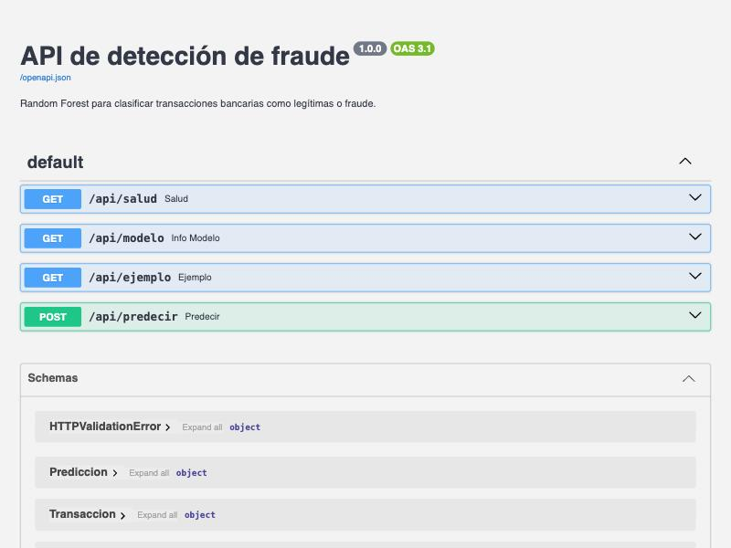
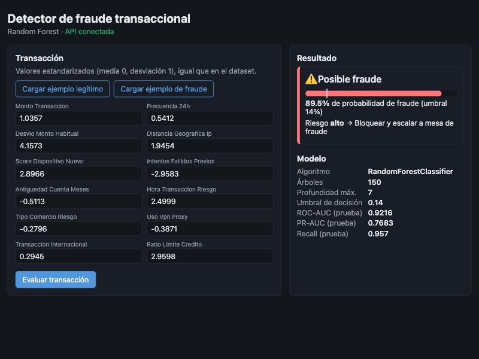

# Documentación técnica — Contenerización y despliegue del detector de fraude

Este documento describe cómo se contenerizó la aplicación de detección de fraude, cómo se integran
frontend y backend mediante una API REST, cómo se ejecuta y valida en local con Docker, qué pruebas se
realizaron y qué estrategias se proponen para desplegarla en la nube.

## 1. Arquitectura

```
                 Navegador
                     │  http://localhost:8080
                     ▼
┌─────────────────────────────────────┐        ┌────────────────────────────────────────┐
│ Contenedor fraude-frontend          │        │ Contenedor fraude-backend              │
│ nginx 1.27 (alpine)                 │ /api/* │ Python 3.14 + FastAPI + Uvicorn        │
│  • Sirve index.html, app.js, CSS    │───────▶│  • Carga modelo_random_forest.joblib   │
│  • Proxy inverso /api → backend:8000│        │  • GET /api/salud, /api/modelo,        │
└─────────────────────────────────────┘        │        /api/ejemplo                    │
             puerto 8080 → 80                  │  • POST /api/predecir                  │
                                               └────────────────────────────────────────┘
                                                            puerto 8000 → 8000
                    Red interna de Docker Compose: faseii_default
```

| Componente | Tecnología | Responsabilidad |
|---|---|---|
| Modelo | scikit-learn `RandomForestClassifier` | Estima la probabilidad de fraude de una transacción. |
| Backend | FastAPI + Uvicorn | Expone el modelo como API REST con validación de datos (Pydantic). |
| Frontend | HTML + JavaScript + nginx | Formulario para capturar la transacción y mostrar el resultado. |
| Orquestación | Docker Compose | Construye y levanta ambos contenedores en una red común. |

**Decisión de integración:** el navegador solo habla con nginx. nginx reenvía `/api/*` al servicio
`backend` por la red interna de Docker. Así frontend y API comparten origen, no hace falta configurar
CORS y el backend no necesita estar expuesto públicamente en producción.

### Estructura de archivos

```
faseII/
├── docker-compose.yml               # Orquestación de los dos servicios
├── .dockerignore
├── requirements.txt                 # Dependencias para entrenar en local
├── DOCUMENTACION.md                 # Este documento
├── datos/
│   ├── datos_fraude.csv             # Dataset (2,500 transacciones)
│   └── metricas_random_forest.json  # Métricas generadas al entrenar
├── fuentes/
│   ├── modelo_random_forest.py      # Entrenamiento y evaluación del modelo
│   ├── prueba_integracion.sh        # Pruebas extremo a extremo contra los contenedores
│   ├── backend/
│   │   ├── Dockerfile
│   │   ├── requirements.txt / requirements-dev.txt
│   │   ├── app/main.py              # API FastAPI
│   │   └── tests/test_api.py        # Pruebas unitarias de la API
│   └── frontend/
│       ├── Dockerfile
│       ├── nginx.conf               # Servidor estático + proxy /api
│       ├── index.html, app.js, estilos.css
└── imagenes/                        # Gráficas del modelo y capturas
```

## 2. Contrato de la API

URL base: `http://localhost:8000/api` (directo) o `http://localhost:8080/api` (a través del frontend).
La documentación interactiva (Swagger/OpenAPI) se genera automáticamente en `http://localhost:8000/docs`.



| Método | Ruta | Descripción | Respuesta |
|---|---|---|---|
| GET | `/api/salud` | Estado del servicio (lo usa el *healthcheck*). | `{"estado":"ok","modelo_cargado":true}` |
| GET | `/api/modelo` | Algoritmo, hiperparámetros, variables, umbral y métricas. | JSON con la ficha del modelo |
| GET | `/api/ejemplo?tipo=legitima\|fraude` | Transacción real del dataset para probar. | Las 12 variables |
| POST | `/api/predecir` | Clasifica una transacción. | Probabilidad, decisión y acción |

**Ejemplo de petición:**

```bash
curl -X POST http://localhost:8080/api/predecir \
  -H 'Content-Type: application/json' \
  -d '{"monto_transaccion": 1.04, "frecuencia_24h": 0.54, "desvio_monto_habitual": 4.16,
       "distancia_geografica_ip": 1.95, "score_dispositivo_nuevo": 2.90,
       "intentos_fallidos_previos": -2.96, "antiguedad_cuenta_meses": -0.51,
       "hora_transaccion_riesgo": 2.50, "tipo_comercio_riesgo": -0.28, "uso_vpn_proxy": -0.39,
       "transaccion_internacional": 0.29, "ratio_limite_credito": 2.96}'
```

**Respuesta:**

```json
{
  "probabilidad_fraude": 0.895,
  "umbral": 0.14,
  "es_fraude": true,
  "nivel_riesgo": "alto",
  "accion": "Bloquear y escalar a mesa de fraude"
}
```

**Reglas de decisión.** El umbral (0.14) es el que minimiza el costo total
(1,500 × FN + 25 × FP) en validación cruzada sobre el entrenamiento:

| Probabilidad | Nivel | Acción |
|---|---|---|
| < 0.14 | bajo | Aprobar transacción |
| 0.14 – 0.50 | medio | Retener y solicitar autenticación reforzada |
| ≥ 0.50 | alto | Bloquear y escalar a mesa de fraude |

**Validación de entrada.** Pydantic exige las 12 variables, todas numéricas, finitas (sin `NaN` ni
`Infinity`) y entre **−100 y 100** (en el dataset ninguna supera |10.06|), y rechaza campos desconocidos.
Cualquier error devuelve `422` con el detalle del campo, que el frontend muestra al usuario.

## 3. Construcción de los contenedores

### 3.1 Backend (`fuentes/backend/Dockerfile`) — construcción multi-etapa

1. **Etapa `entrenamiento`** (`python:3.14-slim`):
   - Instala dependencias de entrenamiento y pruebas.
   - Copia el dataset y `modelo_random_forest.py`, y **entrena el modelo dentro de la imagen**
     (`random_state=42`, por lo que es reproducible). Genera `modelos/modelo_random_forest.joblib`.
   - Copia la API y **ejecuta `pytest`**: si alguna prueba falla, la construcción se detiene y no se
     genera una imagen defectuosa.
2. **Etapa final** (`python:3.14-slim`):
   - Instala solo las dependencias de ejecución (sin pytest ni httpx).
   - Copia únicamente el artefacto `.joblib`, el dataset (para `/api/ejemplo`) y el código de la API.
   - Corre como usuario sin privilegios `api` (UID 1000).
   - Define un `HEALTHCHECK` contra `/api/salud` cada 10 s.
   - Arranca con `uvicorn app.main:app --host 0.0.0.0 --port 8000`.

Las rutas del modelo y de los datos se inyectan con variables de entorno (`RUTA_MODELO`, `RUTA_DATOS`),
y el umbral puede sobreescribirse con `UMBRAL_DECISION` sin reconstruir la imagen.

### 3.2 Frontend (`fuentes/frontend/Dockerfile`)

- Basado en `nginx:1.27-alpine`.
- Copia `nginx.conf` (archivos estáticos + `location /api/ { proxy_pass http://backend:8000/api/; }`)
  y los tres archivos web.
- `HEALTHCHECK` con `wget` a la página principal.

### 3.3 Orquestación (`docker-compose.yml`)

- `backend`: construido desde la raíz (necesita `datos/` y `fuentes/`), puerto `8000:8000`.
- `frontend`: puerto `8080:80`, con `depends_on: condition: service_healthy`, de modo que nginx no
  arranca hasta que la API responde.
- Ambos con `restart: unless-stopped`.
- `.dockerignore` excluye `.venv`, `.git`, cachés, `modelos/` e `imagenes/` para que el contexto de
  construcción sea pequeño y el modelo siempre se entrene dentro de la imagen.

### 3.4 Comandos de construcción

```bash
docker compose build
```

Resultado obtenido:

```
#25 Modelo guardado en modelos/modelo_random_forest.joblib
#23 19 passed, 1 warning in 4.22s
 Image faseii-frontend:1.0.0 Built
 Image faseii-backend:1.0.0 Built
```

| Imagen | Tamaño |
|---|---|
| `faseii-backend:1.0.0` | 660 MB (Python + numpy/pandas/scikit-learn) |
| `faseii-frontend:1.0.0` | 49.7 MB |

## 4. Ejecución local

Requisitos: Docker Desktop en marcha (probado con Docker 24.0.6 y Docker Compose v5.6.1 en macOS arm64).

```bash
docker compose up -d --build     # construir y levantar
docker compose ps                # ver estado y salud
docker compose logs -f backend   # ver logs de la API
docker compose down              # detener y eliminar contenedores
```

Estado tras levantar:

```
NAME              STATUS                    PORTS
fraude-backend    Up (healthy)              0.0.0.0:8000->8000/tcp
fraude-frontend   Up (healthy)              0.0.0.0:8080->80/tcp
```

- Aplicación web: <http://localhost:8080>
- API directa y Swagger: <http://localhost:8000/docs>



### Ejecución sin Docker (desarrollo)

```bash
python3 -m venv .venv
.venv/bin/pip install -r fuentes/backend/requirements-dev.txt
.venv/bin/python fuentes/modelo_random_forest.py               # entrena y guarda el modelo
cd fuentes/backend && ../../.venv/bin/uvicorn app.main:app --reload
```

## 5. Pruebas realizadas

### 5.1 Pruebas unitarias de la API (pytest)

`fuentes/backend/tests/test_api.py` — se ejecutan en local y **automáticamente en cada `docker build`**.

```bash
.venv/bin/pytest fuentes/backend/tests -v
```

| # | Prueba | Qué valida | Resultado |
|---|---|---|---|
| 1 | `test_salud` | `/api/salud` responde 200 y el modelo está cargado | ✅ |
| 2 | `test_info_modelo` | Algoritmo, `n_estimators=150`, `max_depth=7`, 12 variables, umbral en (0,1) | ✅ |
| 3–4 | `test_ejemplo_devuelve_las_12_variables` | Ejemplos legítimo y de fraude traen las 12 variables | ✅ |
| 5 | `test_ejemplo_tipo_invalido` | Un `tipo` desconocido devuelve 422 | ✅ |
| 6 | `test_predecir_estructura_respuesta` | Probabilidad en [0,1] y `es_fraude` coherente con el umbral | ✅ |
| 7 | `test_fraude_recibe_mas_probabilidad_que_legitima_en_promedio` | El modelo asigna más probabilidad a fraudes reales (30 vs 30) | ✅ |
| 8 | `test_predecir_falta_variable` | Falta una variable → 422 | ✅ |
| 9 | `test_predecir_variable_extra` | Campo desconocido → 422 | ✅ |
| 10 | `test_predecir_valor_no_numerico` | Texto en un campo numérico → 422 | ✅ |
| 11–17 | `test_predecir_rechaza_valores_extremos` | `NaN`, `Infinity`, `-Infinity`, `±1e308`, `1e6` y `100.01` → 422 en el campo correcto | ✅ |
| 18–19 | `test_predecir_acepta_valores_en_el_limite` | `100` y `−100` (límites) → 200 | ✅ |

Resultado: **19 passed**.

### 5.2 Pruebas de integración extremo a extremo

`fuentes/prueba_integracion.sh` recorre el mismo camino que el navegador
(**cliente → nginx → backend → modelo**) con los contenedores levantados:

```bash
bash fuentes/prueba_integracion.sh            # por defecto http://localhost:8080
```

```
OK    Frontend sirve index.html
OK    Frontend sirve app.js
OK    Proxy /api/salud -> backend
OK    Proxy /api/modelo -> backend
OK    Ejemplo legítimo tiene 12 variables
OK    Predicción de ejemplo legítimo
OK    Predicción de ejemplo de fraude
      legítima -> {"probabilidad_fraude":0.2678,"umbral":0.14,"es_fraude":true,"nivel_riesgo":"medio",...}
      fraude   -> {"probabilidad_fraude":0.7613,"umbral":0.14,"es_fraude":true,"nivel_riesgo":"alto",...}
OK    JSON incompleto devuelve 422
OK    Ruta inexistente de la API da 404

Todas las pruebas de integración pasaron.
```

> El ejemplo legítimo quedó marcado como riesgo medio: es esperable con el umbral de 0.14, que
> prioriza no dejar pasar fraudes (recall 95.7%) a costa de más falsas alarmas (ver sección 7).

### 5.3 Prueba funcional en el navegador

En <http://localhost:8080> se verificó que:

1. Al cargar la página el indicador cambia a **«API conectada»** y se muestra la ficha del modelo
   (obtenida de `/api/modelo`).
2. El formulario de 12 campos se genera dinámicamente con las variables que devuelve la API.
3. **«Cargar ejemplo de fraude»** rellena el formulario desde `/api/ejemplo`.
4. **«Evaluar transacción»** envía un `POST /api/predecir` y muestra: *Posible fraude, 89.5 %, riesgo
   alto → Bloquear y escalar a mesa de fraude* (captura de la sección 4).

### 5.4 Resiliencia

| Escenario | Resultado |
|---|---|
| Se detiene el backend (`docker stop fraude-backend`) | El frontend sigue sirviendo la página (200); `/api/salud` devuelve **502** y la interfaz muestra «API no disponible» y «Error 502: el servicio de la API no responde.» |
| Se vuelve a iniciar el backend | En pocos segundos pasa a `healthy` y `/api/salud` vuelve a responder `{"estado":"ok"}` sin reiniciar el frontend. |
| El backend no arranca (error en el código) | Compose detecta `unhealthy` y **no levanta el frontend** (`dependency failed to start`). Se comprobó durante el desarrollo. |

### 5.5 Problemas encontrados durante las pruebas y su solución

| Problema | Causa | Solución |
|---|---|---|
| El backend arrancaba y quedaba `unhealthy` con `IndexError` | La ruta por defecto del modelo se calculaba con la estructura de carpetas del repositorio, que no existe dentro de la imagen (`/app/app/main.py`). | Las rutas se toman primero de `RUTA_MODELO` / `RUTA_DATOS` y solo si faltan se calcula la ruta del repositorio. |
| `Infinity` y `1e308` devolvían **500** y `NaN` producía una predicción (200) | El esquema aceptaba cualquier `float`; scikit-learn trabaja en `float32` y falla con infinitos o valores enormes, y el Random Forest acepta `NaN` sin avisar. | Validación `allow_inf_nan=False` y rango `[-100, 100]` en las 12 variables (→ 422), y un manejador de errores que convierte `NaN`/`Infinity` a texto para poder devolver el 422 en JSON válido. 9 pruebas unitarias nuevas. |
| El frontend quedaba `unhealthy` aunque respondía | En Alpine `localhost` resuelve a IPv6 (`::1`) y nginx solo escucha en IPv4. | El *healthcheck* usa `http://127.0.0.1/`. |
| Con el backend caído la interfaz mostraba `Unexpected token '<'…` | nginx devuelve una página HTML de error 502 y el frontend intentaba leerla como JSON. | `app.js` detecta respuestas que no son JSON y muestra «Error 502: el servicio de la API no responde.» |

### 5.6 Rendimiento y recursos

200 peticiones `POST /api/predecir` consecutivas a través de nginx:

| Métrica | Valor |
|---|---|
| Latencia media | 28.7 ms |
| p50 / p95 / máx. | 28.4 / 31.0 / 45.2 ms |
| Memoria backend | ~154 MiB |
| Memoria frontend | ~8 MiB |

## 6. Estrategias de despliegue en la nube

> El procedimiento detallado para AWS (ECS Fargate + Amazon Bedrock) está en
> [MANUAL_NUBE.MD](MANUAL_NUBE.MD).

La aplicación ya está lista para la nube: dos imágenes inmutables, configuración por variables de
entorno, *healthchecks*, usuario sin privilegios y un único punto de entrada público (nginx).

### 6.1 Flujo común

1. **Registro de imágenes**: publicar `faseii-backend` y `faseii-frontend` con etiqueta de versión
   (p. ej. `1.0.0` y el SHA del commit) en un registro privado.
2. **CI/CD con GitHub Actions** (el repositorio ya está en GitHub): en cada *push* a `main`,
   construir las imágenes (el `docker build` ya ejecuta las pruebas), ejecutar
   `prueba_integracion.sh` con `docker compose up`, publicar las imágenes y desplegar.
3. **Despliegue**: actualizar el servicio con la nueva etiqueta y verificar `/api/salud`.

Ejemplo de pipeline:

```yaml
# .github/workflows/despliegue.yml
on: { push: { branches: [main] } }
jobs:
  construir-probar-publicar:
    runs-on: ubuntu-latest
    steps:
      - uses: actions/checkout@v4
      - run: docker compose up -d --build        # entrena + pytest dentro del build
      - run: bash fuentes/prueba_integracion.sh  # pruebas extremo a extremo
      - run: docker compose down
      # login al registro, docker tag/push y despliegue según el proveedor elegido
```

### 6.2 Opciones por proveedor

| Opción | Cómo se despliega | Ventajas | Consideraciones |
|---|---|---|---|
| **Google Cloud Run** *(recomendada para esta fase)* | Dos servicios: frontend público y backend con acceso interno; `nginx.conf` apunta a la URL del backend. | *Serverless*, escala a cero, pago por petición, HTTPS automático. | Arranque en frío (~2–4 s por cargar scikit-learn); se mitiga con `min-instances=1`. |
| **AWS ECS Fargate + ALB** | Imágenes en ECR, una *task definition* con ambos contenedores, *Application Load Balancer* con *health check* en `/api/salud`. | Sin servidores que administrar, integración con IAM, CloudWatch y Secrets Manager. | Más piezas de configurar (VPC, subredes, ALB). |
| **AWS App Runner** | Un servicio por imagen desde ECR. | El más sencillo en AWS. | Menos control de red. |
| **Azure Container Apps** | Imágenes en ACR, *ingress* externo para el frontend e interno para el backend. | Escalado por peticiones, revisiones para *blue/green*. | — |
| **Kubernetes (EKS / GKE / AKS)** | `Deployment` + `Service` por componente, `Ingress` para el frontend, `readinessProbe` en `/api/salud`, HPA. | Máximo control y portabilidad. | Mayor complejidad operativa; se justifica a gran escala. |

### 6.3 Buenas prácticas para producción

- **Seguridad**: exponer solo el frontend/balanceador; backend en red privada. HTTPS en el balanceador.
  Autenticación de la API (API key u OAuth2) antes de abrirla a otros sistemas. Escaneo de
  vulnerabilidades de imágenes (Trivy, ECR/Artifact Registry scanning).
- **Configuración**: umbral y rutas por variables de entorno (`UMBRAL_DECISION`), secretos en el
  gestor del proveedor, nunca en la imagen.
- **Escalado**: el backend es *stateless*, por lo que escala horizontalmente. Escalar por CPU o por
  número de peticiones concurrentes.
- **Despliegues sin corte**: *rolling update* o *blue/green* usando `/api/salud` como *readiness check*.
- **Observabilidad**: logs estructurados a CloudWatch / Cloud Logging, métricas de latencia y tasa de
  errores, y monitoreo de la **distribución de probabilidades** para detectar *drift* del modelo.
- **Gestión del modelo**: versionar el artefacto `.joblib` (registro de modelos o almacenamiento de
  objetos) para reentrenar sin reconstruir la imagen de la API.

## 7. Consideraciones del modelo en producción

- Con el umbral de costo mínimo (0.14) el modelo detecta 89 de 93 fraudes en prueba (recall 95.7 %)
  pero genera 411 falsas alarmas sobre 657 legítimas. Antes de producción conviene acordar con negocio
  un tope de falsas alarmas o usar el nivel «medio» para autenticación reforzada en vez de bloqueo,
  como hace ya la API.
- El modelo entrenado dentro del contenedor obtiene las mismas métricas que en local salvo diferencias
  en el cuarto decimal (PR-AUC 0.7683 vs 0.7686), atribuibles a la plataforma; el recall y la matriz
  de confusión con umbral óptimo coinciden.
